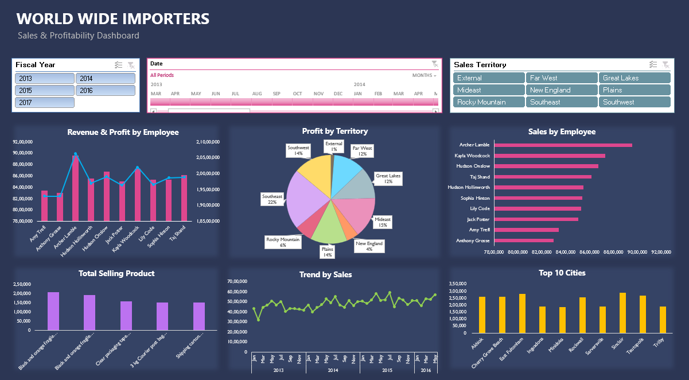

# Employee Data Analysis

An Excel dashboard project built using Power Query and PivotTables to analyze sales and employee performance data.

## What's in this project
- Data was pulled in and cleaned using Power Query, with six tables (Employee, Sales, Date, Customer, City, Stock Item)
- The tables were connected together using Excel's Data Model
- PivotTables summarize sales performance by employee and by product
- A Dashboard sheet brings the key insights together in one view

## Tools Used
- Microsoft Excel
- Power Query
- Power Pivot (Data Model)
- PivotTables and PivotCharts

## Dashboard Preview

